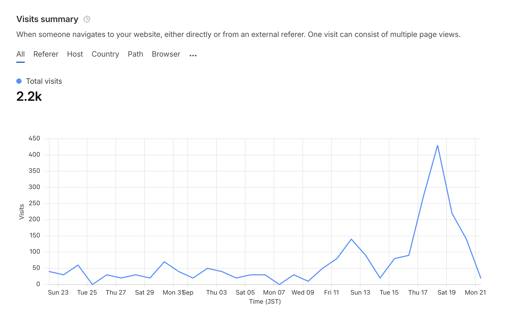
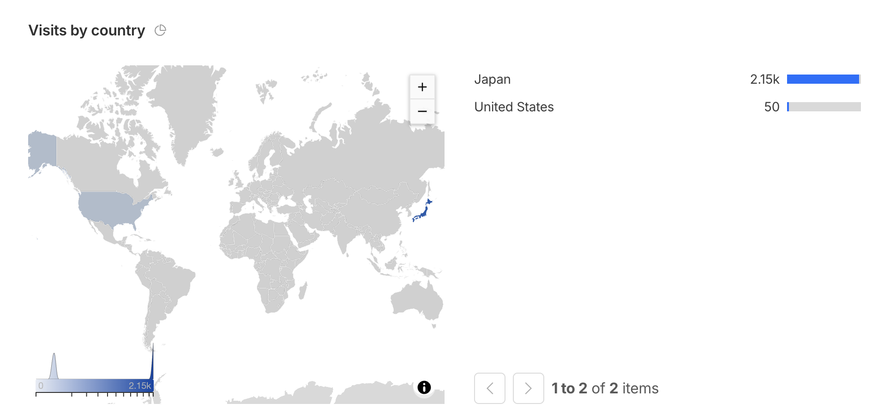
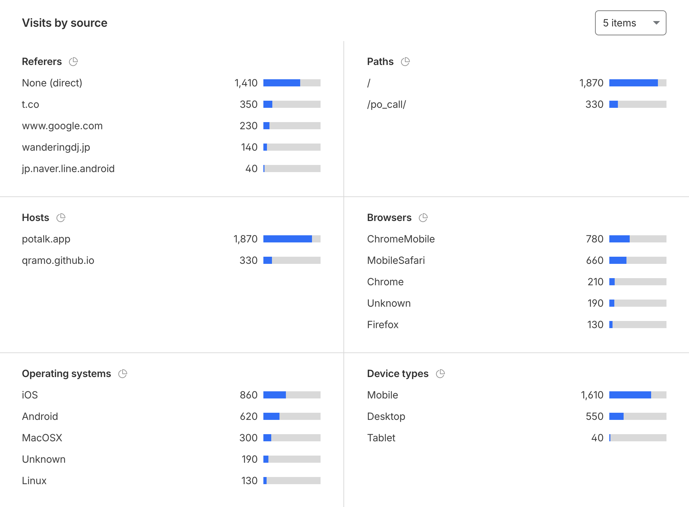
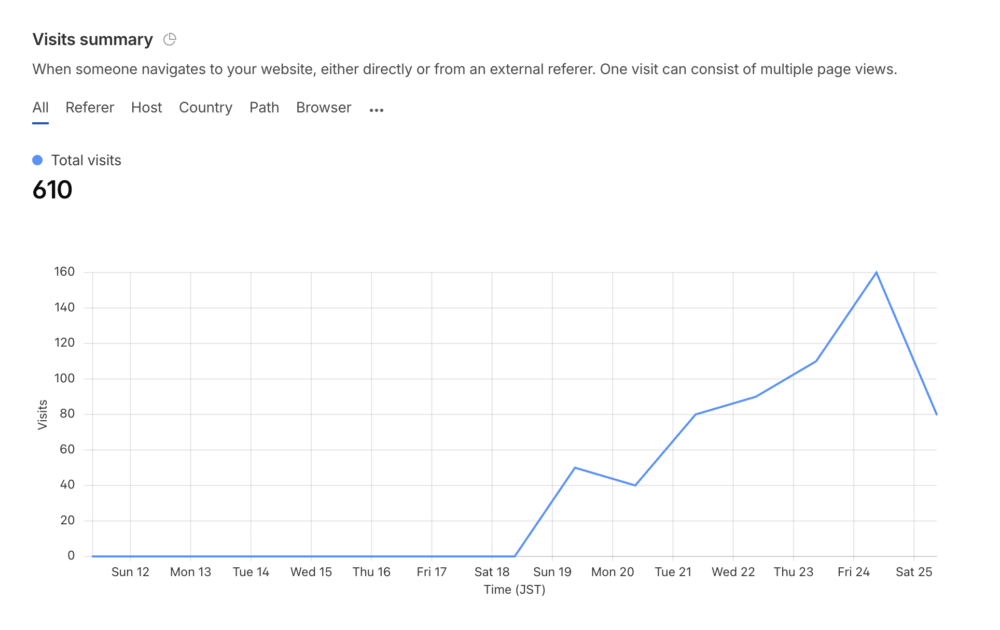
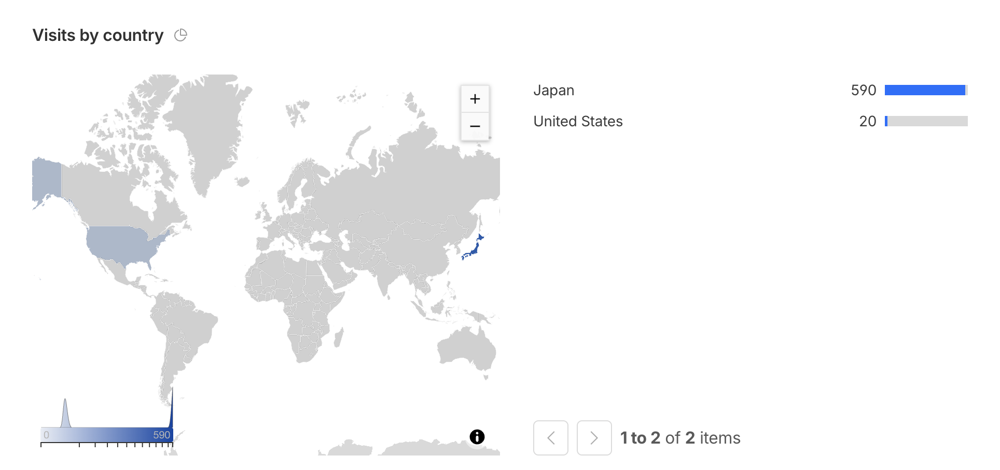
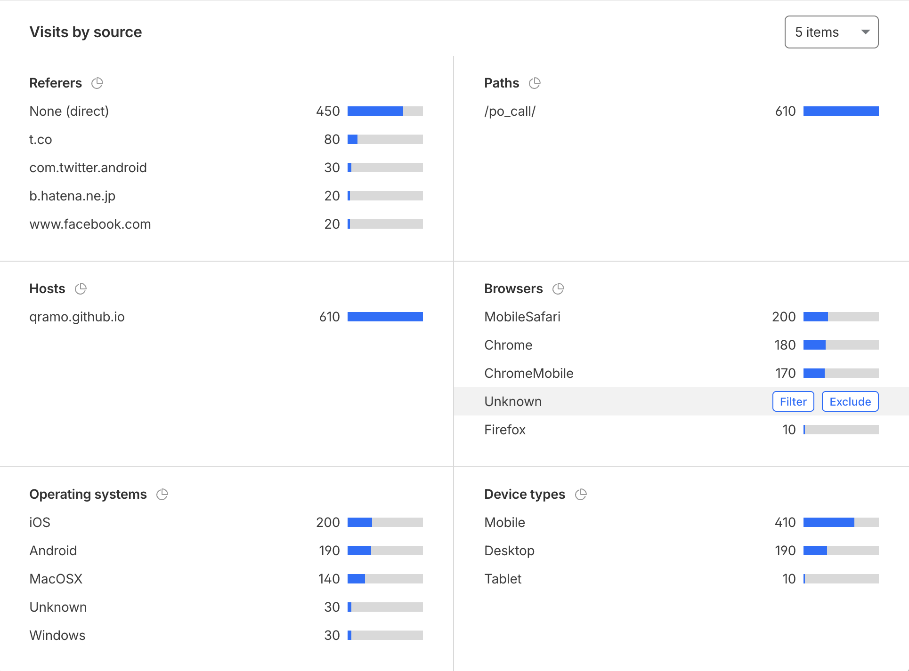

# 🫖 ぽっと通話 (potalk)

同じ部屋名（URL）を開いた人どうしが、そのまま音声通話できる実験的な**静的Webページ**。
サーバ不要・**HTML1枚**（WebRTC 音声 ＋ [Trystero](https://github.com/dmotz/trystero) / Nostr）。既定はプライバシー配慮で **Cloudflare TURN 中継**を通し、相手に自分の IP が見えないようにしている。

**👉 使ってみる： https://potalk.app/**

> 実験用プロジェクトです。利用で生じた不具合・不利益・損害は自己責任で。一般的なモラルを守ってお使いください。

このREADMEは2部構成です：
- **使いたい人へ** … アプリを開いて通話するだけ
- **自分で立てたい人へ** … クローンして自前で動かす／公開する（技術者向け）

---

## 👥 使いたい人へ

**[▶ アプリを開く](https://potalk.app/)** → 名前とアバターを決めて、部屋名を入れて「参加する」。
同じ部屋名（＝共有リンク／QRコード）を相手に渡すか、「通話中の部屋」からタップして入室。

**できること**
- 🧑 名前＋絵文字アバター（ブラウザに保存、次回も引き継ぐ）
- 🗣 話している人の絵文字が声に合わせて跳ねる
- 🔇 参加者のミュート状態を表示
- ☎️ 通話中の部屋を一覧、タップでそのまま入室
- 💬 ひとこと（短いテキスト）とリアクション絵文字。ひとことは流れとしても残る。別のタブを見ている間に届くと 💬 に小さな点が付きます
- 📣 **配信部屋**：あなただけが話し、ほかの人はリスナー。リスナーはマイクを使いません（許可も求められません）。話してほしい人には 🎙 で登壇を許可できます
- 🔚 **配信の終わり方**：配信者の接続が切れるとリスナーの画面で 60 秒待ち、戻らなければ「配信終了」と出て自動で退出します。配信部屋は配信者がいるときだけ一覧に出ます
- 📮 **おたより**（配信部屋）：リスナーが書いたお便りは**配信者にだけ届き**、配信者が選んだものだけが部屋に出ます（ラジオのハガキ募集）
- 🔊 **音量**：この通話の音だけを下げられます（動画や音楽と一緒に聞くとき用。ほかのアプリの音はそのまま）
- 🎵 **BGM**：⚙️ 設定から「軽快な音楽」「アンビエント空間」「焚き火」を選べます（既定はオフ・**自分にだけ鳴ります**・Web Audio で合成するため通信ゼロ）
- 📱 **小窓**：通話中に小さな窓を最前面に浮かべられます。ほかのアプリを見ている間も**通話中だと分かり、タップで一発で戻れます**（ホーム画面に追加したアプリでは使えません）
- 🏷 **話題タグ**：話が変わったら「いまの話題」を後付けできます。誰でも書き換えられ、付けた人の名前が添えられます。通話中の部屋一覧ではタグが見出しになります
- 🚪 **古いリンクでも迷子にならない**：リンクで来たときは、その部屋がいま開いているかを見てから入ります。誰もいなければ「通話中の部屋から選んで参加」か「部屋の名前をつけて参加」を選べます
- 🌗 **見た目が時刻で変わる**：夜は紺、朝夕はミルクティー色、昼は空の色に、一日を通してゆっくり移ります。版表示の横の選択で「端末のダークモードに合わせる」「ずっと昼」「ずっと夜」に固定もできます
- 👥 いまこのページを見ている人数のめやす
- 🌱 使うほど自分の絵文字が育つ
- 🫖 常設の部屋：案内が流れる「ぽっと通話にようこそ」と、声が5秒で返る接続テスト「やまびこ部屋⛰️」

**つかう前に**
- **マイクの許可**が必要。**Safari / Chrome** で開く（アプリ内ブラウザは不可）
- iPhoneでは「音声を有効化」ボタンが出ることがある
- **iPhone は「ホーム画面に追加」ではなく Safari のタブで開く**のがおすすめです。ホーム画面のアプリとして開くと、**他のアプリに切り替えた瞬間に自分の声が届かなくなります**（iOS の仕様で、こちらからは防げません）
- **音を出す他のアプリ（写真・動画など）に切り替えると、通話の音が一時的に止まります**（そのアプリの音が止まれば鳴り直します）
- 人数の上限は **ふつうの部屋8人／📣配信部屋15人**（全員が全員に繋がる仕組みなので、多いほど音が途切れます）
- 実験版なので切断・不具合が起きることがあります
- くわしくはアプリ内の「これはなに？」を参照

**💬 ご意見・質問・不具合報告**
掲示板へどうぞ（**アカウント不要・匿名OK**・みんなで助け合おう）：
**[ぽっと通話 ご意見・質問ばん ↗](https://z.wikiwiki.jp/potalk/)**
※ 掲示板は外部サービス（[zawazawa ↗](https://z.wikiwiki.jp/)）を利用しています。

**📝 紹介していただいた記事**
- [POPOPOの代替、後継アプリを適当に書く ↗](https://wanderingdj.jp/wordpress/2026/08/17/popopo%E3%81%AE%E4%BB%A3%E6%9B%BF%E3%80%81%E5%BE%8C%E7%B6%99%E3%82%A2%E3%83%97%E3%83%AA%E3%82%92%E9%81%A9%E5%BD%93%E3%81%AB%E6%9B%B8%E3%81%8F/) — wanderingdj's（2026/08/17）／POPOPO の後継候補をいくつも見比べたうえで、ぽっと通話にも触れていただきました

---

## 🛠 自分で立てたい人へ

### 構成
- **`index.html` 1枚**。ビルド無し・`node_modules` 無し・バックエンド無し。
- 依存は [Trystero](https://github.com/dmotz/trystero) 1つだけを、実行時に動的 `import`。v0.16.2 から、ファイルは CDN（esm.sh）ではなく**このリポジトリの `vendor/` に同梱**して自分のドメインから配っています（中身は esm.sh の配布物そのまま・`vendor/README.md`）。
- 相手発見／シグナリングは公開 **Nostrリレー**、音声は **WebRTC（ブラウザ間 E2E 暗号化）**。**既定は Cloudflare TURN 中継経由**（`iceTransportPolicy:'relay'`）で、相手に自分の IP が見えないようにしている。TURN 資格情報が取れないときだけ通常の P2P/STUN にフォールバック（後述）。
- 「ロビー（通話中の部屋一覧）」も固定の隠し部屋 `__lobby__` に全員が入り、通話中の人が在室を定期発信して集約する仕組み。**サーバは足していません。**
- 「いま見ている人数」も同じロビーに相乗り。ページを開いた人は通話に入っていなくても `__lobby__` のメッシュに繋がるので、`onPeerJoin`/`onPeerLeave` でピアを数えて `+1`（自分）するだけ。**カウンタ用のサーバも API も無し。**

### ローカルで動かす
`getUserMedia`（マイク）は **https:// か localhost** でしか動かない（`file://` 不可）。

```bash
python3 -m http.server 8000
# → http://localhost:8000 を開く
```

ビルド・lint・test は無し。**2タブ／2端末**で同じ部屋名を開いて繋がればOK。

### 自分の GitHub Pages で公開
1. リポジトリに push
2. **Settings → Pages → Deploy from a branch → `main` / `/(root)`**
3. 数分後 `https://<user>.github.io/<repo>/` で公開（Pages は自動 HTTPS ＝ マイク許可が通る）

### ⚠️ フォークしたら差し替えるもの
そのままデプロイすると**あなたの環境では一部が動きません**。`index.html` 内の以下を自分のものに：

| 項目 | 何が起きる／どうする |
|---|---|
| **TURN Worker URL**（`TURN_WORKER_URL`） | 既定は作者の Cloudflare TURN 資格情報発行 Worker で、**CORS で作者のオリジンに限定**。別オリジンからは弾かれ、**TURN が効かず別ネットワーク間で繋がらない**（STUN のみ＝直結できるペアだけ繋がる）。自分の Worker を用意して URL を差し替え、Worker 側の CORS 許可に自分のオリジンを追加する（下記）。 |
| **`appId`**（`kuramo-webrtc-call`） | 同じ `appId` だと**本家と部屋の名前空間・ロビーを共有**します。独立させたいなら変更。 |
| **Cloudflare Analytics トークン** | `<head>` のビーコンは作者のもの。自分のに差し替えるか、まるごと削除。 |
| アイコン / `manifest.webmanifest` / フォローカード画像 | 好みで差し替え。 |

### 例：見た目だけ変える（泡バージョン）
クローンしてデザインを変えた例として、**泡バージョン「POP DEMO」** があります。

- デモ：[potalk.app/pop_demo/](https://potalk.app/pop_demo/)
- ソース：[github.com/po-talk/pop_demo](https://github.com/po-talk/pop_demo)

`index.html` をコピーして、**画面の部分だけ**を泡（重力と表面張力で漂う丸い UI）に差し替えています。通信の部分（部屋 ID・`appId`・データチャネルの中身）は元のままなので、**本家の画面の人と同じ部屋で話せます**。ロビーの一覧も共有します。
通信の約束ごとは [docs/PROTOCOL.md](docs/PROTOCOL.md) にまとめています。本家の人と同じ部屋で話したいときは、ここに合わせてください（`appId` も変えない）。

### Cloudflare TURN（中継の既定・安定させたい人向け）
本アプリは**既定で音声を必ず TURN 中継**に通します（`iceTransportPolicy:'relay'`）。狙いは **IP プライバシー**（中継なら相手に自分の実 IP が見えない。音声は中継でも DTLS-SRTP で暗号化されたままで、Cloudflare も中身は聞けない）。あわせて対称NAT・セルラーなど直 P2P が張れない環境の救済も兼ねます。無料の公開 TURN は不安定なので、**Cloudflare Realtime TURN ＋ 短命の資格情報を発行する小さな Worker**を推奨（Worker は "合鍵を渡すだけ" で通話は通らない＝運営は通信経路を持たない）。 **この Worker のソースは [`worker/pot-turn.js`](worker/pot-turn.js) に同梱しています**（シークレットは環境変数なので、そのまま自分の Cloudflare に貼って使えます）。

- Cloudflare ダッシュボード → Realtime → **TURN Server** で TURN キー（Key ID / API Token）を作成
- Worker が `POST https://rtc.live.cloudflare.com/v1/turn/keys/$KEY_ID/credentials/generate-ice-servers`（`Authorization: Bearer $API_TOKEN`）を叩いて `iceServers` を返す。CORS で自分のオリジンだけ許可
- ページは起動時にその Worker から `iceServers` を取得し、`rtcConfig.iceServers` として Trystero に渡す
- **relay は資格情報が取れた時だけ**：`trysteroConfig` は `ice` が truthy のときだけ `iceTransportPolicy:'relay'` を付ける。取れないと候補ゼロで全員不通になるため、その場合は relay を外して通常の P2P/STUN にフォールバックする（安全網）
- 参加者リストの **☁️（中継）/ ↔（直結）アイコン**で、各自が中継経由か直結かを自己申告表示（自分の IP が相手に見えるかの可視化）

### Trystero 0.25 系メモ
ネット上の情報の多くは旧 API なので注意：

- **コールバックは代入**：`room.onPeerJoin = id => {}`（`onPeerJoin(fn)` の呼び出し形は廃止）
- **サブパス import は例外**：`trystero/torrent` 等は不可。素の `trystero` は **nostr** 戦略（本アプリはこれ）
- **リレー指定**：`relayConfig:{ urls:['wss://...'], redundancy:N }`。平坦な `relayUrls` / `relayRedundancy` は**無視**される（なお **`urls` を渡すと `redundancy` は効かない**＝渡した一覧が全部使われる。0.25.2 のソースで確認）
- **ICE 指定**：丸ごと差し替えるなら `rtcConfig:{ iceServers:[...] }`。`turnConfig:[{urls,username,credential}]` は既定 STUN に**追加**
- **relay 強制（本アプリの既定）**：`rtcConfig:{ iceServers:[...], iceTransportPolicy:'relay' }` で常に TURN 中継のみ（直 P2P しない＝IP を隠す用途）

### スケール / 注意
- **フルメッシュ**（全員が全員に接続）＝部屋の接続数は N(N-1)/2 で増える。**上限を明示的に置いている**（ふつうの部屋8人・配信部屋15人）。大人数は SFU（LiveKit 等）が必要で、それは「越えない」と決めた境界。
- 満室のときに抜けるのは**あとから入ってきた側だけ**（到着順で判定）。全員が同じ判定を回すと全員が抜けてしまうため。
- ロビーも**閲覧者全員**のデータメッシュ。効くのは通話人数ではなく同時閲覧者数で、**数十人規模で頭打ち**（伸ばすなら Nostr 直 publish 等のサーバレスな方式へ）。
- 「いま見ている人数」はそのメッシュを数えているだけなので **best-effort**。繋がれなかった相手は数に入らず**実数より少なめに出る**（5人きざみに丸め、5人未満を「数人」と濁しているのはそのため）。
- 音声は **E2E 暗号化**（DTLS-SRTP）。**既定の Cloudflare 中継を経由してもバイト列を運ぶだけで中身は復号されず**、運営の設備も通らない。シグナリングは Nostr 公開リレー経由。

---

## 📅 これまでの歩み

- 2026/07/15 POPOPO の終了が発表される。ぽっと通話を構想
- 2026/07/16 ぽっと通話をローンチ（GitHub で作成・公開）
- 2026/07/17 POPOPO の知り合いと遊び始める
- 2026/07/18 通話中の部屋を実装。「誰がいて・誰が話していて・どの部屋がライブか」を可視化
- 2026/07/19
    - 絵文字が育つ成長機能（🌱→🌿→🌷→🌲/🌳）を追加
    - QRコード表示とプロフィールの折りたたみを追加
    - 「これはなに？」ヘルプをモーダル化
    - TURN を Cloudflare へ切り替え
- 2026/07/20 ヘルプを拡充し、README を2部構成に整備
- 2026/07/21
    - 公開・告知を開始（POPOPO プロフィールにリンクを掲載）
    - ChatGPT に[レビューをもらった](https://chatgpt.com/share/6a5ef1cf-9d04-83e8-9724-c0faccb27bb0)
    - スマホの表示領域を有効活用（枠を外して全幅化）
    - 参加後は不要な入力フォーム（名前・部屋名）を畳むように
    - 共有 URL は見た目を一行に省略
    - 「これはなに？」をスクロール優先にし、説明トグルは開くたびリセット
    - コードが1000行を超える
- 2026/07/22
    - 長い部屋名を制限（QRコードが細かくなり読みにくくなるため）
    - 部屋の継続時間を表示（最長在室者のタイマー基準のため、短くなることもある）
    - 部屋名と衝突して崩れていた人数表示を修正
- 2026/07/23
    - 部屋の音声状況に合わせた擬似グラフィックイコライザーを実装
    - OGP 画像を設定し、SNS シェアに対応
- 2026/07/24 — **v0.1.0**
    - P2P 優先をやめ、WebRTC を既定で中継経由に変更
    - 絵文字で代用していたパーツを画像化
    - ブログ等に貼れるアクティブバナーを実装
- 2026/07/25
    - 入退室の通知音を追加 🔈
    - 新しい部屋を検出したときの通知音を追加 🔈
    - 接続経路の表示（☁️中継 / ↔直結）を参加者リストに追加
- 2026/07/27
    - 開発の歩み（この一覧）を README にまとめた
    - ライセンスを MIT に決めて公開
    - アクセス状況を透明性のため公開
- 2026/07/28
    - 「POへようこそ」に自動再生の案内音声を設置（一人で来ても音が流れる）
    - サポート用の掲示板を用意し、「これはなに？」からリンク
- 2026/07/29
    - いまページを見ている人数を表示
    - 長時間つづく部屋の継続時間が他人からは24時間で頭打ちになっていたのを修正
    - 初めて来た人の名前とアバターをランダムに提案
- 2026/07/31 — **v0.5.0**（つながりやすさと安全性の回）
    - **「つなぎ直す」が実は繋ぎ直せていなかったのを修正**（ページを読み直す方式に変更）
    - 相手の声が届かないとき、**相手に「送り直して」と自動でお願いする**ようにした
    - 「音声を有効化」が用もないのに出て、押しても何も起きなかったのを修正
    - 壊れた URL で開くとアプリ全体が動かなくなるのを修正
    - 圏外・Wi-Fi オフのときに「インターネットに繋がっていません」と伝えるようにした
    - 回線が戻ったときに、通話中の部屋の一覧がすぐ復活するようにした
    - 参加ボタンの連打や、参加に失敗したときマイクが止まらない問題を修正
    - 部屋名に混ぜられた見えない文字で表示が崩される問題に対処
    - 公開リレーに流していた在室情報から名前を外した（絵文字だけに）
    - 外部レビューを2本もらい、指摘を反映。動作確認を自動化（手元の回帰テスト）
- 2026/08/02
    - 長い通話に後から入ると繋がらないことがある問題を修正（中継の資格情報を通話中に入れ替える）
    - 接続経路（中継／直接）の見かたを画面に出した
    - **`https://potalk.app/` へ引っ越し**（URL から個人名を外した。旧URLもそのまま使えます）
- 2026/08/03〜05
    - 引っ越しの後片づけ（ヘルプのリンクと表記を新しい名前・場所に揃えた）
    - 成長の花を 🌷 と 🌻 の2種類に分けた（短く何度も／長くときどき、で分かれます）
    - ロビーの一覧から部屋に入るときは、**マイクを切った状態で入る**ようにした
- 2026/08/14 — **v0.5.1**（静かに壊れていたものを直した回）
    - どれも「なんとなく不安定」としか見えていなかったものです
    - 繋がらなかった接続を閉じるようにした（溜まり続けてブラウザの上限に当たっていた）
    - **通話が20〜40分で突然切れる**のを修正（中継の資格情報の寿命が30分だった）
    - シグナリングのリレーを実測で入れ替え（**5本中4本が死んでいた**。部屋の取りこぼしの主因）
- 2026/08/15 — **v0.6.0**（相手ごとの「無視」とリアクション）
    - 参加者リストのハートで、**その人の音を受け取らない**ようにできる（相手には伝わりません）
    - 定型リアクション8つ。押した人のアバターから浮かび、音も鳴ります（音は切れます）
    - **つながりが切れたら、自分でつなぎ直す**ようにした（これまでは再読み込みが必要でした）
    - 「退出した」のか「接続が切れた」のかを書き分けるようにした
    - 旧URL `qramo.github.io/po_call/` は、**新機能を先に試す場**になりました（版の横に β が出ます）
- 2026/08/15 — **v0.7.0**（ひとこと）
    - **短いテキストを送れる**ようにしました。送ると、その人のアイコンから吹き出しが出ます
    - 履歴は残りません（後から入った人には見えません）。その場だけのものです
    - **無視した相手のひとことは出ません**（リアクションと同じ）
    - リアクションの音を絵文字ごとに作り分けました（拍手・クラッカーなど）
    - スマホで入力欄をタップすると画面が拡大する問題を修正
    - スマホでキーボードを出すと参加者リストの頭が見切れる問題を修正
- 2026/08/16 — **v0.8.0**（📣 配信部屋・ひとことの流れ・人数上限・画面の整理）
    - **📣 配信部屋**を追加。部屋名の下で選ぶと、**あなたの声だけが流れる部屋**になります
        - 聞き役で入った人は**マイクを使いません**（許可も求められません）
        - 話してほしい人には 🎙 で**登壇を許可**できます。許された人は「マイクを使う」を押して初めてマイクが入り、取り消すと自動で止まります
        - 共有リンクは**1種類だけ**。配信者かどうかは**部屋を作った端末**で決まります（配信者用の秘密のリンクはありません）
        - 「話してよい人」の一覧は配信者が**署名して配り**、各自のブラウザが確かめてから音を鳴らします。**名乗るだけでは配信者になれません**
    - **ひとことが流れとして残る**ようになりました（吹き出しは消えても、入力欄の上に残ります）
    - **人数の上限**を置きました（ふつうの部屋8人／配信部屋15人）。混んできたら先に知らせます
    - 通話中の画面を**タブ**に分けました（👥メンバー／💬ひとこと／⚙️設定）。高さが変わらないので、押す場所が動きません
- 2026/08/17 ブログ **[wanderingdj's ↗](https://wanderingdj.jp/wordpress/2026/08/17/popopo%E3%81%AE%E4%BB%A3%E6%9B%BF%E3%80%81%E5%BE%8C%E7%B6%99%E3%82%A2%E3%83%97%E3%83%AA%E3%82%92%E9%81%A9%E5%BD%93%E3%81%AB%E6%9B%B8%E3%81%8F/)** で紹介していただきました
- 2026/08/18 — **v0.8.1**（📮 おたより）
    - 配信部屋で**お便りを募集**できるようにしました。聞き役が書いたものは**配信者にだけ届き**、配信者が選んだものだけが部屋に出ます（ラジオのハガキ募集）
    - 公開されたお便りは**どのタブを見ていても**大きな紙で出ます。ほかの人の投稿は見えません
- 2026/08/18 — **v0.8.2〜v0.8.5**（細かい直しの回）
    - スマホでタブの文字が折り返す／普通の部屋に「おたより」タブが出てしまう問題を修正
    - 参加者リストを**左は見るだけ・右は押すもの**に整理しました
    - β（旧URL）から安定版へ移れる導線を追加。Google の検索結果でファビコンが空になるのも直しました
- 2026/08/18〜19 — **v0.8.6 / v0.8.7**（🔊 音量）
    - **この通話の音だけ**を下げられるようにしました（動画や音楽と一緒に聞くとき用）
    - ※ iPhone は音量指定を**受け付けたふりをして無視する**ため、端末を見分ける方法がありません。**全端末で同じ仕組み**（Web Audio）に統一して解決しました
- 2026/08/19 — **v0.8.8**（🎵 BGM）
    - ⚙️ 設定から **軽快な音楽**／**アンビエント空間**を選べます（既定はオフ）
    - **自分にだけ鳴ります**（相手には送っていません）。曲は**部屋名から決まる**ので、通信は一切増えません
    - 音源ファイルを持たず、その場で合成しています（＝権利関係の心配がありません）
- 2026/09/12 — **v0.8.9**（マイクの取り方を明示）
    - Android の一部機種で音が回り込む（ハウリング）報告を受けて、**エコーキャンセル等を明示的に指定**するようにしました
- 2026/09/12 — **v0.9.0**（音が止まったまま戻らない問題）
    - iPhone で**他のアプリに切り替えると、戻ってきても BGM や相手の声が鳴らないまま**になることがある問題を直しました
    - ※ 背面にいる**あいだ**に音が止まるのは iOS の仕様で防げません。直したのは**戻ったあとに鳴り直すこと**です
- 2026/09/14 — **v0.9.1〜v0.10.3**（音の出口の作り直しと 📱 小窓）
    - **iPhone で BGM や効果音がほとんど聞こえない**問題を直しました。音の出し方そのものを変えています（スピーカーへ直接ではなく、音声プレイヤーを通す形へ）
    - **📱 小窓**を追加。通話中に小さな窓を最前面に浮かべられます。ほかのアプリを見ている間も通話中だと分かり、**タップで一発で戻れます**
    - 音を出す他のアプリに切り替えて通話の音が止まっても、**自動で鳴り直す**ようにしました
    - BGM が背面で途切れることがある問題を修正
    - **音量を下げると自分の声が返ってくる**不具合を修正しました（v0.8.7 から入っていたものです）
    - 最初の画面を **「名前を決める → 部屋を選ぶ」** の流れに整理しました（部屋を新しく作る欄は畳んであります）
- 2026/09/17 — **v0.11.0〜v0.11.4**（🌗 昼と夜）
    - **見た目が時刻で変わる**ようになりました。夜は今までの紺、朝夕はミルクティー色、昼は空の色に、一日を通してゆっくり移ります（夜明けと日没は溶けるように切り替わります）
    - 版表示の横の選択で「端末のダークモードに合わせる」「ずっと昼」「ずっと夜」に固定できます
    - 6人以上の部屋で参加者リストの端が途中で切れて見えていたのを、端を溶かす形に直しました
- 2026/09/17 — **v0.11.5〜v0.11.6**（配信部屋のリンクまわり）
    - 配信部屋のリンクから入るとき、部屋の種類（配信部屋／雑談部屋）を選べてしまうのをやめました。リンクの部屋がそのまま部屋です
    - 部屋名の欄に触っただけで普通の部屋に化けることがある問題を直しました（名前を実際に変えたときだけ別の部屋になります）
    - 聞き役として入るときは、ボタンが**「リスナーとして参加する」**になります
- 2026/09/18 — **v0.11.7〜v0.11.8**（通話中のボタンを下へ）
    - **ミュート／退出／音声を有効化**を、参加者リストの下（招待リンクの上）に移しました。スマホで参加者リストを見ているときに、そのまま指が届きます
    - ミュートを大きく、退出を小さめに（3：2）
- 2026/09/18 — **v0.11.9**（BGM の連射を修正）
    - iPhone で他のアプリに音を取られたあと、戻った瞬間に **BGM が「ダダダダ」と連射される**ことがある問題を直しました（起こし直しが何本も重なっていました）
- 2026/09/18 — **v0.12.0〜v0.12.1**（入口の確認）
    - リンクで来たときは、**その部屋がいま開いているかを見てから**入るようにしました。開いていれば「いま開いています」、誰もいなければ「この部屋にはいま誰もいないみたいです」と案内し、**通話中の部屋から選ぶ**か、**部屋の名前をつけて参加**するかを選べます
    - 背景：以前に告知した古いリンクや QR から、誰もいない部屋に迷い込む人がいたためです
- 2026/09/18 — **v0.13.0〜v0.13.3**（部屋のしくみの作り直しと 🏷 話題タグ）
    - **部屋の実体を、名前ではなくランダムな ID にしました**。招待リンクは `#room=ID&name=部屋名` の形になります。同じ名前の部屋が別々に存在でき、古いリンクで部屋が勝手に復活しません
    - 以前の形のリンク（`#部屋名`）は入口として動きます。その名前の部屋が開いていれば合流し、無ければ「お休み中」の案内になります
    - **🏷 話題タグ**を追加。通話中に「いまの話題」を付けられ、相手にも通話中の部屋一覧にも出ます（誰でも書き換え可・付けた人の名前つき）
    - BGM の曲は部屋の ID で決まるようになりました（名前を変えても曲は変わりません）
- 2026/09/18 — **v0.13.4**（ひとことの未読の点）
    - 別のタブを見ている間にひとことが届くと、**💬 ひとことタブに小さな点**が付くようにしました。開くと消えます
- 2026/09/18 — **v0.13.5**（退出の確認）
    - 退出ボタンを押すと確認が出るようにしました（誤タップで会話から落ちないように）
- 2026/09/19 — **v0.13.6**（Trystero 0.25.4）
    - 相手探しに使うライブラリ Trystero を 0.25.4 に更新しました。つながったあとの告知が 5 秒ごとから 60 秒ごとになり、公開 Nostr リレーへの負荷が大きく減ります（リレー `x.kojira.io` を運用する kojira さんからの [PR #2](https://github.com/po-talk/po-talk.github.io/pull/2) を取り込みました。ありがとうございます）
- 2026/09/19 — **v0.13.7**（常設の案内部屋の名前）
    - 案内が流れる常設の部屋の名前を「POへようこそ」から**「ぽっと通話にようこそ」**に変えました
- 2026/09/19 — **v0.14.0**（配信の終わり方）
    - 配信者の接続が切れたら、聞き役の画面で **60 秒待ち**、戻れば何事もなく続きます。戻らなければ「配信が終了しました」と出て、**15 秒後に自動で退出**して通話中の部屋一覧へ戻ります（放置したタブの掃除も兼ねます）
    - 配信部屋は**配信者がいるときだけ**一覧に出るようにしました。聞き役だけが残った部屋に新しい人が流れ込みません
- 2026/09/20 — **v0.14.1〜v0.14.8**（ページ内の確認・招待リンクのコピー）
    - 話題タグの入力欄で、日本語入力の変換を確定する Enter でタグが送られてしまうのを直しました
    - 退出・通話中の部屋の移動・「無視」の初回説明の確認を、ブラウザのダイアログからページ内の 2 択にしました。ダイアログの間はページが止まり、閉じた瞬間に BGM が連なることがあったためです
    - iPhone で退出した直後に「プププ」と音の切れ端が鳴ることがあるのを直しました
    - 📱 小窓に部屋の ID（ランダムな文字列）が出ていたのを、部屋名が出るように直しました
    - 「招待リンクをコピー」で、**「部屋名 - あなたの名前」と改行、そのあとに URL** が入るようにしました。SNS に貼ったときに何の部屋か分かります。表示されているリンクをタップすると URL だけがコピーされます
- 2026/09/20 — **v0.14.9〜v0.14.23**（★ iPhone で「つなぎ直す」後に相手の声が戻らない件）
    - 相手の音声トラックは届いているのに中身が流れてこない、という状態を見張るようにしました。その場合は相手に「送り直して」と頼み、送り直された音声を確実に受け取ります（同じ相手からの 2 本目の音声を「同じもの」として捨てていたのが、声が戻らなかった正体です）。参加してから 10 秒前後で自動的に鳴り始めます
    - 参加者リストの「無視」の印（割れたハート）を、2 つの破片が左右へ開いた形にしました
    - ヘルプの説明文をいまの動きに合わせ、「ひとこと」「おたより」の送信ボタンを青緑にしました（退出ボタンと押し間違えないように）。あわせてコードを整理しました
- 2026/09/21 — **v0.14.24〜v0.14.25**（案内ページ）
    - 案内ページ [potalk.app/start/](https://potalk.app/start/) を作りました。いつもある 2 つの部屋（はじめましての部屋／やまびこ部屋）に人がいるかどうかが見えます。[使い方](https://potalk.app/manual/)・[しくみ](https://potalk.app/tech/)・[運営](https://potalk.app/about/)のページも同時に。いつもある部屋への直リンクは、入口の確認を挟まずに入れます
    - 「これはなに？」を短くし、詳しい説明は案内ページへ（別タブで開くので通話は続きます）。制作者のリンクを X（@qraPo3）にしました
- 2026/09/22〜23 — **v0.14.26〜v0.14.29**（登壇の引き継ぎ・🔥 焚き火）
    - 配信部屋でマイクの許可（登壇）をもらった人が、「つなぎ直す」やリロードで入り直しても許可が引き継がれるようにしました。配信者が入り直したときも、残っている人の許可は消えません
    - BGM に「🔥 焚き火」を追加しました。炎のメラメラ、炭のチリチリ、ときどき弾けるパチパチを Web Audio で合成しています
    - 通話中の部屋一覧に「部屋のリンクをコピー」ボタンを付けました
    - 退出後に部屋名を書き換えたとき、確実に新しい部屋が作られるよう直しました
- 2026/09/24〜25 — **v0.14.30〜v0.14.32**（守りを固める）
    - セキュリティ監査の指摘を受けて、案内ページの在室表示の描き方を安全な形に改め、配信部屋の鍵の保護を強めました。中継サーバーの候補が 0 件のとき・入口の確認のタイマー・ロビーの退出待ちの扱いも直しました
    - 改造したクライアントからの連打に、受け取る側で身を守るようにしました（描き直しを間引く・登壇の復元要求は一定間隔でだけ応じる・満室判定の待ちが延び続けない）
    - 焚き火の音量を倍にしました
- 2026/09/25〜26 — **v0.14.33〜v0.14.41**（🗣 ひとことの読み上げ・OS の音声合成で試した回）
    - 設定に「🗣 ひとことを読み上げる」を追加しました（既定オフ）。人が話している間は間が空くまで待ち、名前を頭に付け、URL は「URL省略」、絵文字は読みません。読んでいる間はその人の行が「話している」表示になります
    - iPhone / iPad では、消音スイッチで鳴らない・マイクを使っている間は読んだあと相手の声が戻らない、という OS 側の壁に当たりました。回避を何通りか試しましたが（v0.14.35〜40）ページからは直せず、マイクを使う部屋では読み上げを止めました
- 2026/09/26〜27 — **v0.14.42〜v0.14.55**（読み上げの作り直し：つくよみちゃん）
    - OS の音声合成をやめ、ブラウザの中で動く合成エンジン piper-plus と「つくよみちゃん」の声で読むようにしました。音は BGM と同じ出口から出るので、iPhone の消音スイッチや通話音が戻らない問題に影響されません
    - 使えるのは配信部屋の配信者です。配信者の端末で合成した声が 2 本目の音声として部屋の全員に届き、メンバー一覧に「つくよみちゃん」の行（公式イラストの顔）が現れます。古い版の相手には送らないので、混在しても配信者の声は途切れません。設定の下に「届いている人：n / m 人」が出ます
    - 配信者自身のひとことも読みます。同じ人のひとことが続くときは名前を省き、長い名前は 12 文字までにします。「投稿した人の名前は読まない」スイッチもあります
    - メモリ対策：合成のたびに増えていたメモリを頭打ちにし、読み込み時の量も減らしました。声のモデルは int8 に量子化してリポジトリに同梱しています（26.5 MB・聞こえ方は同じ）。読み上げの設定は保存せず、ページを開くたびにオフから始まります（「つなぎ直す」のときだけ引き継ぎます）
    - 聞き役の「つくよみちゃん」の行は、音が実際に届いているときだけ出します。届かないまま 15 秒たつと自動で受け取りをやり直します
    - 声：つくよみちゃんコーパス（夢前黎）／エンジン：piper-plus（MIT）。クレジットはヘルプと THIRD_PARTY_NOTICES にあります
- 2026/09/26〜28 — **v0.14.49・v0.14.56〜v0.14.61**（BGM と画面の細かい直し）
    - 一部の端末で BGM を「なし」にしたときに「ぶぶぶぶ…」と鳴り止まなくなる問題と、iPad などで BGM に混ざっていたプチプチ音を直しました
    - 焚き火 BGM を作り込みました。炎の呼吸のようなゆらぎ、左右に舞う火の粉、燃え上がるときだけ膨らむ低い響き、乾いた「パリッ」。調整用のページも作りました（実験用のページは 2026/10/09 に公開から外しました）
    - 話題タグの付いた部屋で、一覧の元の部屋名を目立たせました。設定タブはもう一度押すと直前のタブに戻ります
    - 畳んだ「部屋を作る」を少し目立たせ、参加ボタンの文言を場面で変えるようにしました（「部屋を作る」「配信を始める」「参加する」「リスナーとして参加する」）
    - 読み上げに英単語のカタカナ辞書を入れました（約 120 語。hello・WebRTC・iPhone など）。辞書は増やせます（掲示板で募集中）
- 2026/09/28 — **v0.15.0**
    - **ひとことの読み上げが本番に入りました。** 配信部屋で配信者がオンにすると、送られた「ひとこと」をつくよみちゃんの声が読み上げ、部屋の全員に聞こえます。合成はブラウザの中だけで動き（piper-plus）、文章がどこかのサーバへ送られることはありません。初回だけ約 40 MB を読み込みます（2 回目からは端末に残ります）
    - 通話中の部屋一覧でも、読み上げがオンの部屋には「つくよみ」が並ぶようにしました。入る前にその部屋で読み上げが使われていることが分かります（人数には数えません）
    - **配信部屋を聞いている人は、部屋の一覧に名前が出なくなりました。** 一覧に並ぶのは配信者と、マイクを渡された人だけです（人数はこれまでどおり全員ぶん出ます）。聞きに来たことを知られずに済みます。話す側になった人は名前が出ます
- 2026/09/29 — **v0.15.1〜v0.15.5**（音の戻りと読み上げの安定）
    - 動画など音を出すほかのアプリに切り替えて戻ったとき、通話の音（相手の声・BGM・読み上げ）が自動で鳴り直すようにしました。これまでは無音のままになり、「つなぎ直す」を押すしかないことがありました
    - 「つなぎ直す」を繰り返すと端末のメモリが足りなくなって読み上げが止まる問題を直しました（合成エンジンを最初のひとことが届くまで読み込まない）
    - 読み上げが失敗したときの表示を、**起きたことと直し方が分かる日本語**にしました。くわしい手順は[つかいかたの「困ったとき」](https://potalk.app/manual/#trouble)にあります
    - 配信部屋で聞いている人が全員いなくなったとき、配信者の画面がひとりでに再読み込みされることがあったのを直しました
    - 読み上げの発音を直す日本語の読み辞書を入れました（まず「成る程」→「なるほど」）。おかしな読みを見つけたら[ご意見・質問ばん](https://z.wikiwiki.jp/potalk/)に教えてください
- 2026/09/29〜30 — **v0.15.6〜v0.15.15**（配信部屋で、黙って聞く自由）
    - 配信部屋のメンバーに並ぶのは、配信者・マイクを渡された人・「通話希望」を出した人（🙋）だけになりました。ほかに聞いている人は「🙂 ほか N 人が聞いています」と人数だけ出ます。黙って聞いていることが、ほかの聞き手にも配信者にも見えません
    - 聞き役のコメントはこれまでどおり「ひとこと」に出ます。吹き出しやリアクションは「ほか N 人」のところに一瞬出ます
    - 「🙋 通話希望者募集」を付けました（配信者の設定）。オンにすると聞いている人に「通話希望」ボタンが出て、押すと配信者のメンバーに並びます。配信者はこれまでどおり 🎙 で許可します
    - 聞き役として入ると、ひとことに「〇〇さんが入室しました」と出ます（読み上げがオンなら声でも歓迎します）。ロビーから「🤫 静かに入る」を選ぶと「誰かが静かに入室しました」となり、名前は出ません。退室のときは何も出ません
    - 緑の案内（「配信部屋です」など）を右上の × で閉じられるようにしました。内容が変わったときはまた出ます。ほか、表示の細かい直し
- 2026/09/30 — **v0.15.16〜v0.15.18**（BGM の引き継ぎ・ひとことから無視）
    - 部屋に入ったとき、その場の BGM を初期値としてもらえるようにしました。配信部屋では配信者の BGM に合わせます（あとで自分で変えれば、それが優先）。雑談部屋では、BGM を「なし」にしている人だけ、一番長くいる人の BGM をもらいます
    - ひとこと（コメント）の行から、その人を無視できるようにしました。行をタップすると名前の隣にハートが出て、押すとその人の声・コメント・リアクションを受け取らなくなります（相手には伝わりません）。無視した人の過去のコメントは一行に畳まれ、取り消せば戻ります。一覧に出ない聞き役でも、コメントした人はここから無視できます
    - 無視した人のコメントを配信者のつくよみちゃんが読み上げると聞こえてしまっていたのを直しました。その間だけ、あなたの端末ではつくよみちゃんの声が消えます（配信者にも相手にも伝わりません）
- 2026/10/03 — **v0.15.19**（通話希望者募集の取りこぼし）
    - 配信部屋で「🙋 通話希望者募集」をオンにしたあとに入ってきた人に、「通話希望」ボタンが出ないことがあったのを直しました（これまでは配信者が募集をオンオフし直すと出ていました）
- 2026/10/06 — **v0.15.20〜v0.15.22**（入ってきた人の声が届くまで・「🔄 つながり中…」）
    - 新しく入ってきた人の声が届くまでを短くしました（これまでは 8 秒ほどかかることがありました）。通話の途中は、短い途切れで「音がまだ届いていません」が出すぎないよう、これまでどおりの判定です
    - 部屋にいるのにまだつながっていない人を、メンバー一覧に「🔄 つながり中…」と出すようにしました（人数には数えません）。回線の具合によっては、つながるまで 1 分ほどかかることがあります
- 2026/10/08 — **v0.15.23**（常設の部屋の名前）
    - 案内が流れる「ぽっと通話にようこそ」とやまびこ部屋を、ほかの部屋と同じしくみ（ランダムな部屋 ID＋名前）に移しました。ぽっと通話以外のアプリからも部屋の名前が見えるようになります。古いリンクやブックマークからも、これまでどおり入れます
- 2026/10/09 — **v0.15.24**（通話中の部屋の一覧）
    - 通話中の人がタブを閉じたときなど、誰もいなくなった部屋が一覧から消えるまでを 3 秒ほどにしました。回線が一瞬揺れただけなら、部屋が一覧から点滅して消えないようにもしています
- 2026/10/09 — **v0.15.25**（安全性の見直し）
    - 外部のチェック手順でアプリを点検し、見つかったところを直しました。古い形式のリンク（#部屋名）で来たとき、同じ名前の部屋が複数開いていたら自動では選ばず、一覧から選んでもらうようにしました。古いリンクから入るときはミュートで始まります。読み上げの案内は配信者からのものだけを受け付けるようにしました。開発中に使った実験用のページは公開をやめました
- 2026/10/09 — **v0.15.26**（リンクの入口）
    - 共有リンクで来たとき、部屋がしばらく見つからないと「誰もいないみたい」と出て参加ボタンが消えていました。そこに「このまま入ってみる」を足しました。見つけるのに時間がかかっているだけなら、そのまま中の人とつながれます
- 2026/10/09 — **v0.15.27**（リレーの入れ替え）
    - 相手を見つけるのに使っている公開リレーのうち、使えなくなっていた 1 本を後継のリレーに入れ替えました
- 2026/10/10 — **v0.15.28**（配信者の本人確認）
    - 配信部屋で、配信者がいったん抜けたあと、その人の識別子を名乗る別人が入ってきても配信者として扱われないようにしました。中に入るとき、配信者には鍵を使った本人確認（名乗りだけでは通らない合い言葉のやり取り）を求め、確認が取れて初めて声と配信者の合図を受け取ります。ふだんの使い勝手は変わりません
- 2026/10/10 — **v0.15.29**（入室通知・ロビーの共有）
    - 配信部屋に入ったとき、「〇〇 さんが入室しました」の通知が本人の画面には出ていませんでした。ほかの人に見えているのと同じ 1 行を、自分の「ひとこと」にも出すようにしました
    - ロビーの部屋カードの共有ボタンが URL だけをコピーしていたのを、招待リンクのコピーと同じ「部屋名 - 名前」＋URL の形にしました
- 2026/10/10 — **v0.15.30**（共有の名前）
    - 招待リンクとロビーのカードでコピーする「部屋名 - 名前」の名前を、配信部屋では配信者の名前に、雑談部屋ではいま部屋にいる人の名前の並び（5 人まで。多ければ「ほか N 人」）にしました。誰の部屋か・誰がいるかがひと目で分かります
- 2026/10/10 — **v0.15.31**（新しい部屋の知らせ）
    - ロビーを開いたままほかの画面を見ていても、部屋が始まったことに気づけるようにしました。パソコンでは「パソコンの通知でも知らせる」をオンにすると、通話や配信が始まったときに通知が出ます（タブを開いている間だけ）
    - タブの名前に「● 2部屋で通話中」のように通話中の部屋の数が出て、アイコンに緑の点が付きます。見ていない間に新しい部屋ができると「🔔 新しい部屋」になります
    - 案内役・やまびこの部屋は、ボット以外の人が入ったときだけ数えて知らせます。一瞬途切れて戻っただけの部屋は、もう一度は知らせません
- 2026/10/12 — **v0.16.0〜v0.16.10**（名刺・安全・使い勝手）
    - **名刺（プロフィールカード）**を作れるようになりました。メンバーの絵文字や名前を押すと、その人のひとこと・アイコン画像・SNS・お礼の窓口が、本人の端末から直接届きます（相手の端末には残りません）
    - SNS の本人確認（𝕏・GitHub・Nostr）は、**見た人が自分で確かめる**しくみです。「✅ を確かめる」を押すと、その場でその人の SNS に本人の印があるかを確かめ、確かめられたものにだけ ✅ が付きます。名乗るだけでは ✅ は付きません
    - お礼の窓口は、確かめた人や配信者のものはふつうに、そうでないものは控えめに出し、押す前に注意が出ます。Nostr Zap は行き先のアドレスまで確かめ、ウォレットのアプリが無くてもアドレスをコピーできます
    - アイコン画像は、ドラッグで位置、つまみで大きさを決めて切り抜けます。大きな写真でも端末の中で小さくしてから使います。SNS には YouTube も載せられます（いまは自己申告）
    - 通話のライブラリを外の CDN からではなく、このサイト自身から配るようにしました（中身は同じ・つながる相手も同じ）
    - 名前やひとことに見えない文字を混ぜた「なりすまし」を防ぐため、見えない文字を取り除くようにしました
    - パソコンの日本語入力で、変換を確定する Enter でひとことが送られてしまうのを直しました
    - 配信部屋で、後から入った人に「おたより」の募集が出ないことがあるのを直しました
    - 名刺とおたよりの紙は、外側をタップしても閉じます。通話中に花が育ったとき、相手のメンバー一覧にもすぐ反映されます
- 2026/10/22 — **v0.16.11〜v0.16.13**（大音量から耳を守る）
    - 相手から急にとても大きな音（割れた音や爆音）が届いたら、**その人の音だけを自動で小さく**するようにしました。ふつうの声の人はこれまでどおりそのまま聞こえます
    - 小さくしている間は、その人の行に 🔉 が出ます。知らせは 20 秒出るので、何が起きたか分かります。使い方の「急にとても大きな音が来たら？」に、自分でできることもまとめました
- 2026/10/23 — **v0.16.14**（読み上げの部品もこのサイトから）
    - 配信者が使う「ひとことの読み上げ」の声の合成エンジンも、外の CDN からではなく、このサイト自身から配るようにしました（中身は同じ）。これで、ページが読み込むプログラムはすべてこのサイトから届きます（アクセス数の計測を除く）
- 2026/10/27 — **v0.16.15**（通話中の部屋の並べ替え）
    - 通話中の部屋の並べ替えを設定しました
- 2026/11/10 — **v0.16.25**（画面の見直し・ぽちっと通話と相乗り）
    - 画面を見直しました。ミュートや退出、リアクションを画面の下の盤にまとめ、「シェア」でカードを裏返すと招待の QR コードが出ます
    - 押している間だけ話せる「ぽちっと通話」（リョータさん作）と相乗りしました。[potalk.app/ptt/](https://potalk.app/ptt/) でも使え、ぽちっと通話の部屋も通話中の部屋の一覧に並びます
- 2026/11/11 — **v0.16.26**（ぽちっと通話の新しい部屋番号）
    - ぽちっと通話の部屋番号に使える文字が増えたのに合わせました。一覧に出ていなかった部屋も並ぶようになり、[potalk.app/ptt/](https://potalk.app/ptt/) も新しい版になりました
- 2026/11/13 — **v0.16.28**（通話中の知らせを上から出すカードに）
    - 大きな音を小さくした・音が止まっている・接続が切れた などの知らせを、画面の上から重ねて出すカードにしました。続けて届いても前の知らせが消えず、閉じた知らせは ⏱️ から読み返せます
- 2026/11/13 — **v0.16.27**（後から入った人とつながりやすく）
    - 後から部屋に入った人と、声が片方しか届かないことが減り、つながるのも速くなりました。つなぐ準備を先に作り置きせず、相手が来てから作るようにしています（リョータさんの提案。日本各地の 4 人で試しました）。[potalk.app/ptt/](https://potalk.app/ptt/) も同じにしました
    - 通話中の部屋の一覧で、カード右上の共有ボタンがちらついたり、押しても反応しなかったりするのを直しました
    - メンバー一覧のいちばん上の人のひとことの吹き出しが、上のタブに隠れていたのを直しました（そのときだけ自分の行に重ねて出します）
    - 雑談部屋でも、後から入ってきた人を「〇〇さんが入室しました」とひとことに出すようにしました。自分が入ったときも、一人目でも同じ行が出ます（配信部屋も同じ）

---

## 📊 アクセス状況（透明性のため公開）

このアプリは [Cloudflare Web Analytics](https://www.cloudflare.com/web-analytics/)（**Cookie不使用・個人を特定しない匿名集計**）で**アクセス数だけ**を測っています。透明性のため、その集計を公開します。個々の通話内容・在室・音声は一切測っていません（そもそも測る仕組みがありません）。

**集計期間：2026/08/23〜09/21（JST）／累計訪問数：2,200**

> ※ この数字は 2026/09/21 時点のものです（最終更新 2026/09/21）。次の集計で差し替えます。**このぶんから、本番（potalk.app）と旧URL（β・qramo.github.io/po_call/）を合算**しています（下の過去の集計は旧URLのみ）。
数値は Cloudflare 側で10単位に丸められた概数。**9/19 に約430/日でピーク**。



**ホスト別（本番 / 旧URL）**

| ホスト | 訪問 |
|---|--:|
| potalk.app（本番） | 1,870 |
| qramo.github.io（旧URL・β） | 330 |

**国別**

| 国 | 訪問 |
|---|--:|
| 日本 | 2,150 |
| アメリカ | 50 |



**参照元（どこから来たか・上位5）**

| 参照元 | 訪問 |
|---|--:|
| なし（直接アクセス） | 1,410 |
| t.co（X / Twitter） | 350 |
| www.google.com（検索） | 230 |
| wanderingdj.jp | 140 |
| jp.naver.line.android（LINE） | 40 |

**デバイス / OS / ブラウザ**

| デバイス | 訪問 | | OS | 訪問 | | ブラウザ | 訪問 |
|---|--:|---|---|--:|---|---|--:|
| モバイル | 1,610 | | iOS | 860 | | Chrome Mobile | 780 |
| デスクトップ | 550 | | Android | 620 | | Mobile Safari | 660 |
| タブレット | 40 | | macOS | 300 | | Chrome | 210 |
| | | | 不明 | 190 | | 不明 | 190 |
| | | | Linux | 130 | | Firefox | 130 |



<details>
<summary>📜 過去の集計（2026/07/12〜07/25・旧URLのみ・累計訪問数 610）</summary>

数値は Cloudflare 側で10単位に丸められた概数、2026/07/26 時点のスナップショットです。公開した 7/19 以降に立ち上がり、告知を広げた **7/24 に約160/日でピーク**。当時はすべてページ全体（当時のURL `qramo.github.io/po_call/`）へのアクセスです。



**国別**

| 国 | 訪問 |
|---|--:|
| 日本 | 590 |
| アメリカ | 20 |



**参照元（どこから来たか）**

| 参照元 | 訪問 |
|---|--:|
| なし（直接アクセス） | 450 |
| t.co（X / Twitter） | 80 |
| com.twitter.android | 30 |
| b.hatena.ne.jp（はてなブックマーク） | 20 |
| www.facebook.com | 20 |

**デバイス / OS / ブラウザ**

| デバイス | 訪問 | | OS | 訪問 | | ブラウザ | 訪問 |
|---|--:|---|---|--:|---|---|--:|
| モバイル | 410 | | iOS | 200 | | Mobile Safari | 200 |
| デスクトップ | 190 | | Android | 190 | | Chrome | 180 |
| タブレット | 10 | | macOS | 140 | | Chrome Mobile | 170 |
| | | | Windows | 30 | | Firefox | 10 |
| | | | 不明 | 30 | | 不明 | ※ |



※ ブラウザの「不明（Unknown）」は元画面で数値が隠れていたため未記載。

</details>

---

## 📄 ライセンス

[MIT](LICENSE) で公開しています。自由に使用・改変・再配布できます（著作権表示の保持が条件）。

利用・同梱している第三者ソフトウェアの著作権表示は [THIRD_PARTY_NOTICES.md](THIRD_PARTY_NOTICES.md) にまとめています ── [Trystero](https://github.com/dmotz/trystero)（MIT）、[qrcode-generator](https://github.com/kazuhikoarase/qrcode-generator)（MIT）、[nostr-tools](https://github.com/nbd-wtf/nostr-tools)（Unlicense）、アイコンは [Lucide](https://lucide.dev/)（ISC）。
読み上げ（配信部屋）は [piper-plus](https://github.com/ayutaz/piper-plus)（MIT）と [onnxruntime-web](https://github.com/microsoft/onnxruntime)（MIT）をブラウザ内で動かし、声と顔はフリー素材キャラクター「つくよみちゃん」（https://tyc.rei-yumesaki.net/ ・声：つくよみちゃんコーパス／Illustration by 夢前黎）を[キャラクターライセンス](https://tyc.rei-yumesaki.net/about/terms/)に従って使っています。

---

🙏 テストに協力してくれたみんな、ありがとう！
- リョータさん
- アサコさん
- 田上光さん
- croutonさん
- hertzさん
- 名無しさん
- まを まをさん
- しーちゃんさん

制作 ♨️🦈 qramo(ｸﾗﾓ) on POPOPO ／ 開発は [Claude Code](https://claude.com/claude-code) / [OpenClaw](https://openclaw.ai) と一緒に。
